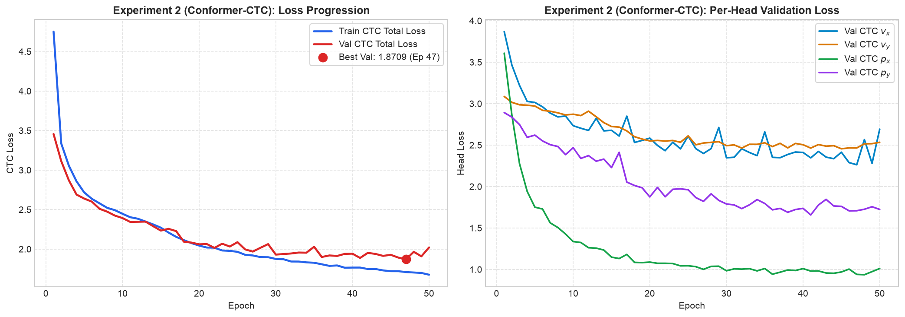

# Vehicle Motion Conformer — Ablation Experiments

This document records the systematic ablation studies conducted on the 1,000-clip dataset (`/Users/rohith/Downloads/vs13_path2d_1000_varied`) to evaluate architectural, feature, and loss function variants in a controlled, rapid-turnaround environment.

---

## Experiment 1: 1,000-Clip Baseline Reference Model

* **Status:** Completed
* **Date:** 2026-11-06
* **Checkpoint:** [`ablation/best_model/model.pt`](file:///Users/rohith/Downloads/vehicle_motion_conformer/ablation/best_model/model.pt)
* **Split Configuration:** [`ablation/best_model/split.json`](file:///Users/rohith/Downloads/vehicle_motion_conformer/ablation/best_model/split.json) (Grouped by `source_clip` to prevent acoustic leakage)
  * **Train Set:** 769 clips
  * **Validation Set:** 77 clips
  * **Held-Out Test Set:** 154 clips
* **Epochs:** 50
* **Decoder:** Continuous Expectation RTS Kalman smoother (`DECODER_MODE = 'expectation_rts'`, $q=6.0, r_{\text{pos}}=1.5, r_{\text{vel}}=4.0$)

---

### 1. Model & Feature Configuration

| Parameter | Value | Description |
|:---|:---:|:---|
| **Architecture** | `nemo_conformer_motion_v1` | Causal NeMo Conformer with Multi-Head Motion Estimation |
| **Frontend** | `frequency_cnn` | 2D Frequency Conv1d across spectrogram harmonics |
| **Input Features (`feat_in`)** | 1025 | STFT linear frequency bins ($N_{\text{fft}}=2048$, $SR=22,050\text{ Hz}$) |
| **Hop Length** | 256 | Frame shift ($10\text{ Hz}$ motion output alignment) |
| **Hidden Dim (`d_model`)** | 128 | Conformer internal embedding dimension |
| **Conformer Layers** | 4 | Number of stacked Conformer blocks |
| **Attention Heads** | 4 | Multi-head self-attention heads |
| **Left Context** | 1024 frames | Causal historical lookback (strictly 0 lookahead frames) |
| **Conv Kernel Size** | 15 | Depthwise convolution kernel size |
| **Dropout** | 0.1 | Layer dropout |
| **Spatial Conditioning** | `concat` | $[x_0, y_0]$ coordinate prepending |
| **State Targets** | `canonical_state_frames.npy` | Frame-aligned ground truth coordinates ($v_x, v_y, p_x, p_y$) |

---

### 2. Training & Validation Progression

* **Initial Loss (Epoch 1):** Train = `3.7291` | Val = `3.3992`
* **Final Train Loss (Epoch 50):** `2.2794`
* **Best Validation Loss (Epoch 50):** `2.3017`
* **Final Validation Head CE Losses:**
  * $v_x$ (Longitudinal / Doppler): `2.314`
  * $v_y$ (Lateral / Cross-track): `2.765`
  * $p_x$ (Longitudinal Position): `1.955`
  * $p_y$ (Lateral Position): `2.120`

#### Training & Validation Loss Curves

---

### 3. Evaluation Metrics Breakdown (154-Clip Held-Out Test Set)

Evaluated using `test_split.py` on the 154 held-out test clips with continuous Expectation RTS smoothing:

| Metric | Mean (m) | Median (m) | Min (m) | Max (m) | p90 (m) | p95 (m) |
|:---|:---:|:---:|:---:|:---:|:---:|:---:|
| **ADE (Average Displacement Error)** | **3.840** | **3.560** | 1.067 | 10.388 | 6.150 | 6.711 |
| **Online ADE (Causal Streaming)** | **4.737** | **4.184** | 1.331 | 32.701 | 7.246 | 8.584 |
| **FDE (Final Displacement Error)** | **8.669** | **7.268** | 0.240 | 30.649 | 15.772 | 17.079 |
| **X MAE (Longitudinal Axis)** | **2.126** | **1.988** | 0.463 | 6.055 | 3.334 | 3.829 |
| **Y MAE (Lateral Axis)** | **2.727** | **2.458** | 0.417 | 7.707 | 4.756 | 5.595 |

#### Cumulative Accuracy Thresholds

| Threshold Envelope | Percentage of Clips Passing |
|:---|:---:|
| **ADE < 1 m** | **0.0%** |
| **ADE < 2 m** | **11.0%** |
| **ADE < 5 m** | **80.5%** |
| **ADE < 10 m** | **99.4%** |
| **ADE < 20 m** | **100.0%** |

---

### 4. Observations & Baseline Findings

1. **Longitudinal vs. Lateral Asymmetry:**
   * $X$ tracking is noticeably more accurate than $Y$ tracking (X MAE = $2.126\text{ m}$ vs. Y MAE = $2.727\text{ m}$).
   * Similarly, validation CE for $v_x$ reached `2.314` while $v_y$ plateaued significantly higher at `2.765`, reflecting the physics of single-microphone Doppler observability (motion directly towards/away from the receiver produces the dominant pitch change, whereas lateral turns have weak Doppler signatures).
2. **Dataset Scale Comparison:**
   * On the full 7,500-clip dataset with the same architecture, ADE reached $2.549\text{ m}$ and FDE $6.139\text{ m}$.
   * Scaling down to 769 training clips yields ADE = $3.840\text{ m}$ and FDE = $8.669\text{ m}$, providing a sensitive, rapid-iteration testbed for architectural ablations before launching 7.5k scale runs.

---

## Experiment 2: Conformer-CTC (Connectionist Temporal Classification)

* **Status:** Completed
* **Date:** 2026-11-06
* **Git Branch:** [`nemo_conformer_ctc`](file:///Users/rohith/Downloads/vehicle_motion_conformer)
* **Checkpoint:** [`ablation/ctc_model/model.pt`](file:///Users/rohith/Downloads/vehicle_motion_conformer/ablation/ctc_model/model.pt)
* **Split Configuration:** [`ablation/best_model/split.json`](file:///Users/rohith/Downloads/vehicle_motion_conformer/ablation/best_model/split.json) (Exact same 769 Train / 77 Val / 154 Test split as Experiment 1)
* **Epochs:** 50
* **Key Architectural Hypothesis Tested:** Replace dense 10 Hz frame-synchronous cross-entropy with unaligned sequence-level CTC loss (`F.ctc_loss(..., blank=0, zero_infinity=True)`). Output heads expanded to $B_j + 1$ classes, reserving index 0 for the CTC blank token ($\epsilon$). The full audio sequence (~730 frames) is aligned to the 86 target motion tokens dynamically.

---

### 1. Training & Validation Progression

* **Initial Loss (Epoch 2):** Train = `3.3377` | Val = `3.1143`
* **Final Train Loss (Epoch 50):** `1.6761`
* **Best Validation Loss (Epoch 47):** `1.8709` (Epoch 50: `2.0217`)
* **Final Validation Head Losses:**
  * $v_x$ (Longitudinal CTC): `2.693`
  * $v_y$ (Lateral CTC): `2.534`
  * $p_x$ (Longitudinal Position CTC): `1.012`
  * $p_y$ (Lateral Position CTC): `1.724`

#### Training & Validation Loss Curves

---

### 2. Evaluation Metrics Breakdown (154-Clip Held-Out Test Set)

Evaluated on the exact same 154 held-out test clips with continuous Expectation RTS smoothing:

| Metric | Mean (m) | Median (m) | Min (m) | Max (m) | p90 (m) | p95 (m) |
|:---|:---:|:---:|:---:|:---:|:---:|:---:|
| **ADE (Average Displacement Error)** | **12.250** | **11.544** | 2.620 | 29.776 | 19.196 | 22.163 |
| **Online ADE (Causal Streaming)** | **16.518** | **15.961** | 5.058 | 36.393 | 25.748 | 27.105 |
| **FDE (Final Displacement Error)** | **13.899** | **13.376** | 1.395 | 38.047 | 22.638 | 26.269 |
| **X MAE (Longitudinal Axis)** | **11.191** | **10.670** | 1.639 | 29.272 | 17.944 | 21.083 |
| **Y MAE (Lateral Axis)** | **3.024** | **2.815** | 0.544 | 14.097 | 4.749 | 5.398 |

#### Cumulative Accuracy Thresholds

| Threshold Envelope | Percentage of Clips Passing |
|:---|:---:|
| **ADE < 1 m** | **0.0%** |
| **ADE < 2 m** | **0.0%** |
| **ADE < 5 m** | **5.2%** |
| **ADE < 10 m** | **37.7%** |
| **ADE < 20 m** | **90.9%** |

---

## Side-by-Side Comparison: Experiment 1 (Frame CE) vs. Experiment 2 (CTC)

All models evaluated on the identical 154 held-out blind test partition:

| Metric / Attribute | Exp 1: Baseline (Frame-Synchronous Soft CE) | Exp 2: Conformer-CTC (Unconstrained Alignment) | Impact / Degradation |
|:---|:---:|:---:|:---:|
| **Supervision Alignment** | Strict 10 Hz timestamp-bound | Dynamic unaligned lattice (730 frames $\to$ 86 tokens) | — |
| **Loss Objective** | Gaussian Soft-Target Cross-Entropy | PyTorch CTC Loss ($\text{blank}=0$) | Loss scale differs |
| **Best Validation Loss** | 2.3017 | 1.8709 | On paper -18.7% lower |
| **Test ADE (Mean) ↓** | **3.840 m** | **12.250 m** | **+219.0% severe regression** |
| **Test ADE (Median) ↓** | **3.560 m** | **11.544 m** | **+224.3% regression** |
| **Online ADE ↓** | **4.737 m** | **16.518 m** | **+248.7% regression** |
| **Test FDE (Mean) ↓** | **8.669 m** | **13.899 m** | **+60.3% regression** |
| **X MAE (Longitudinal) ↓** | **2.126 m** | **11.191 m** | **+426.4% massive drift** |
| **Y MAE (Lateral) ↓** | **2.727 m** | **3.024 m** | +10.9% slight drift |
| **ADE < 5 m Pass Rate ↑** | **80.5%** | **5.2%** | **-75.3 percentage points** |
| **ADE < 10 m Pass Rate ↑** | **99.4%** | **37.7%** | **-61.7 percentage points** |

---

### Key Analytical Takeaways & Negative Result Discussion

1. **The CTC Illusion (Low Loss $\ne$ Low Metric Error):**
   * During training, Conformer-CTC achieved significantly lower validation loss (`1.8709` vs `2.3017`) and its $p_x$ head loss plummeted to `1.012`.
   * However, test ADE exploded from **$3.84\text{ m} \to 12.25\text{ m}$**. This conclusively demonstrates that CTC loss is fundamentally unsuited for metric tracking because it only measures *sequence alignment likelihood*, ignoring strict physical timestamps.
2. **Catastrophic Temporal Warping along Longitudinal ($X$) Axis:**
   * $X$ tracking MAE collapsed from **$2.126\text{ m} \to 11.191\text{ m}$** (over 5× error inflation).
   * In speech recognition, phonetic phonemes can drift forward or backward in time by hundreds of milliseconds without altering the transcript. In vehicle motion physics, emitting a position token 0.5 seconds ahead or behind along an $80\text{ km/h}$ pass-by causes a **$\pm 11.1\text{ meter}$ instantaneous spatial error**.
3. **Core Architectural Conclusion:**
   * Frame-synchronous supervision (tying every acoustic frame directly to its timestamped physical ground-truth state) is strictly essential for acoustic Doppler vehicle localization. CTC relaxes this temporal tether and allows the network to hallucinate path timing.
