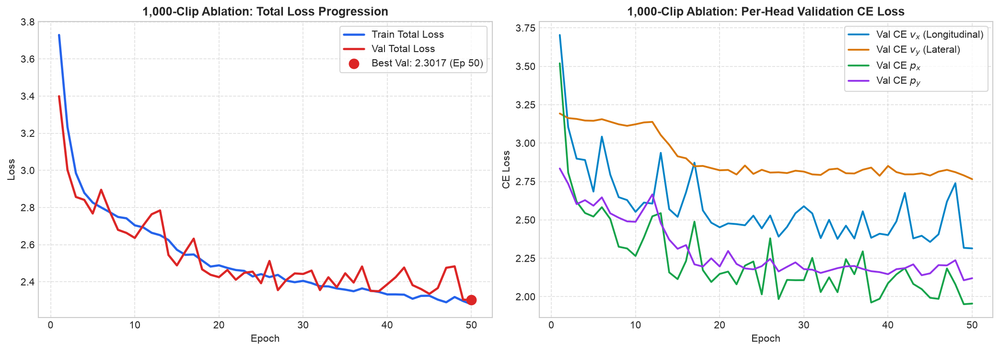

# Vehicle Motion Conformer — Ablation Experiments

This document records the systematic ablation studies conducted on the 1,000-clip dataset (`/Users/rohith/Downloads/vs13_path2d_1000_varied`) to evaluate architectural, feature, and loss function variants in a controlled, rapid-turnaround environment.

---

## Experiment 1: 1,000-Clip Baseline Reference Model

* **Status:** Completed
* **Date:** 2026-11-06
* **Checkpoint:** [`ablation/best_model/model.pt`](file:///Users/rohith/Downloads/vehicle_motion_conformer/ablation/best_model/model.pt)
* **Split Configuration:** [`ablation/best_model/split.json`](file:///Users/rohith/Downloads/vehicle_motion_conformer/ablation/best_model/split.json) (Grouped by `source_clip` to prevent acoustic leakage)
  * **Train Set:** 769 clips
  * **Validation Set:** 77 clips
  * **Held-Out Test Set:** 154 clips
* **Epochs:** 50
* **Decoder:** Continuous Expectation RTS Kalman smoother (`DECODER_MODE = 'expectation_rts'`, $q=6.0, r_{\text{pos}}=1.5, r_{\text{vel}}=4.0$)

---

### 1. Model & Feature Configuration

| Parameter | Value | Description |
|:---|:---:|:---|
| **Architecture** | `nemo_conformer_motion_v1` | Causal NeMo Conformer with Multi-Head Motion Estimation |
| **Frontend** | `frequency_cnn` | 2D Frequency Conv1d across spectrogram harmonics |
| **Input Features (`feat_in`)** | 1025 | STFT linear frequency bins ($N_{\text{fft}}=2048$, $SR=22,050\text{ Hz}$) |
| **Hop Length** | 256 | Frame shift ($10\text{ Hz}$ motion output alignment) |
| **Hidden Dim (`d_model`)** | 128 | Conformer internal embedding dimension |
| **Conformer Layers** | 4 | Number of stacked Conformer blocks |
| **Attention Heads** | 4 | Multi-head self-attention heads |
| **Left Context** | 1024 frames | Causal historical lookback (strictly 0 lookahead frames) |
| **Conv Kernel Size** | 15 | Depthwise convolution kernel size |
| **Dropout** | 0.1 | Layer dropout |
| **Spatial Conditioning** | `concat` | $[x_0, y_0]$ coordinate prepending |
| **State Targets** | `canonical_state_frames.npy` | Frame-aligned ground truth coordinates ($v_x, v_y, p_x, p_y$) |

---

### 2. Training & Validation Progression

* **Initial Loss (Epoch 1):** Train = `3.7291` | Val = `3.3992`
* **Final Train Loss (Epoch 50):** `2.2794`
* **Best Validation Loss (Epoch 50):** `2.3017`
* **Final Validation Head CE Losses:**
  * $v_x$ (Longitudinal / Doppler): `2.314`
  * $v_y$ (Lateral / Cross-track): `2.765`
  * $p_x$ (Longitudinal Position): `1.955`
  * $p_y$ (Lateral Position): `2.120`

#### Training & Validation Loss Curves

---

### 3. Evaluation Metrics Breakdown (154-Clip Held-Out Test Set)

Evaluated using `test_split.py` on the 154 held-out test clips with continuous Expectation RTS smoothing:

| Metric | Mean (m) | Median (m) | Min (m) | Max (m) | p90 (m) | p95 (m) |
|:---|:---:|:---:|:---:|:---:|:---:|:---:|
| **ADE (Average Displacement Error)** | **3.840** | **3.560** | 1.067 | 10.388 | 6.150 | 6.711 |
| **Online ADE (Causal Streaming)** | **4.737** | **4.184** | 1.331 | 32.701 | 7.246 | 8.584 |
| **FDE (Final Displacement Error)** | **8.669** | **7.268** | 0.240 | 30.649 | 15.772 | 17.079 |
| **X MAE (Longitudinal Axis)** | **2.126** | **1.988** | 0.463 | 6.055 | 3.334 | 3.829 |
| **Y MAE (Lateral Axis)** | **2.727** | **2.458** | 0.417 | 7.707 | 4.756 | 5.595 |

#### Cumulative Accuracy Thresholds

| Threshold Envelope | Percentage of Clips Passing |
|:---|:---:|
| **ADE < 1 m** | **0.0%** |
| **ADE < 2 m** | **11.0%** |
| **ADE < 5 m** | **80.5%** |
| **ADE < 10 m** | **99.4%** |
| **ADE < 20 m** | **100.0%** |

---

### 4. Observations & Baseline Findings

1. **Longitudinal vs. Lateral Asymmetry:**
   * $X$ tracking is noticeably more accurate than $Y$ tracking (X MAE = $2.126\text{ m}$ vs. Y MAE = $2.727\text{ m}$).
   * Similarly, validation CE for $v_x$ reached `2.314` while $v_y$ plateaued significantly higher at `2.765`, reflecting the physics of single-microphone Doppler observability (motion directly towards/away from the receiver produces the dominant pitch change, whereas lateral turns have weak Doppler signatures).
2. **Dataset Scale Comparison:**
   * On the full 7,500-clip dataset with the same architecture, ADE reached $2.549\text{ m}$ and FDE $6.139\text{ m}$.
   * Scaling down to 769 training clips yields ADE = $3.840\text{ m}$ and FDE = $8.669\text{ m}$, providing a sensitive, rapid-iteration testbed for architectural ablations before launching 7.5k scale runs.
